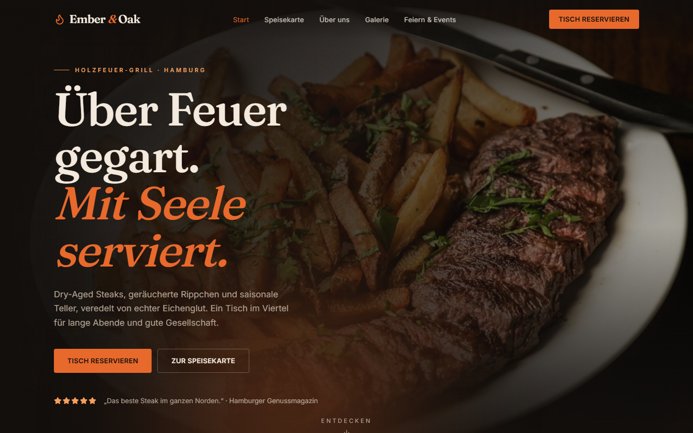

# Ember & Oak: restaurant demo website

**Live-Demo:** https://PHosseini03.github.io/restaurant/ · **Alle Demos:** https://PHosseini03.github.io/website-showcase/

A warm, editorial website for a wood-fired grill. Charcoal and ember tones, Fraunces serif headlines, full-bleed food photography. React + TypeScript frontend and a FastAPI backend.

**Language:** the whole site is in German (formal *Sie*): all UI text, menu, demo data, API messages, euro prices (`de-DE`), 24-hour times and a Hamburg address. API field names, enum values and URL paths stay in English.

## Features
- Cinematic hero, chef story, chef's specials and press quotes
- **Menu** with category tabs and dietary filters (vegetarian, vegan, gluten-free), loaded from the API
- **Table reservations**: date picker (up to 90 days ahead), live seating times from the API (closed Mondays, last seating 90 min before close, 40 covers per slot), party size 1-12, confirmation card
- **Private events** inquiry form (10-120 guests)
- Gallery with keyboard-accessible lightbox, opening hours (today highlighted), 404 page
- Works offline: menu, hours and seating times fall back to bundled demo data
- Fully responsive (360px to 1440px+), accessible forms, respects reduced-motion

## Pages
`/` · `/menu` · `/about` · `/gallery` · `/events` · `/reserve` · anything else shows the 404 page

## Run it
| Part | Port | Command (from this folder) |
|---|---|---|
| API | 8004 | `cd backend; python -m venv .venv; .venv\Scripts\pip install -r requirements.txt; .venv\Scripts\python -m uvicorn app.main:app --port 8004` |
| Web | 5174 | `cd frontend; npm install; npm run dev` |

Open http://localhost:5174. API docs: http://localhost:8004/docs. Or run `..\start-site.ps1 restaurant` from the root folder.

## API
| Method | Path | Purpose |
|---|---|---|
| GET | `/api/health` | Health check |
| GET | `/api/menu?category=&tag=` | Menu items (optional category / dietary tag filter) |
| GET | `/api/specials` | Chef's specials |
| GET | `/api/hours` | Weekly hours, address, phone |
| GET | `/api/availability?date=YYYY-MM-DD` | Seating times for a date |
| POST | `/api/reservations` | Book a table (10/min) |
| POST | `/api/events` | Private event inquiry (10/min) |

All responses use `{ "success": bool, "data": ..., "error": string | null }`.

## Quality
- Backend: `pip install -r requirements-dev.txt; pytest --cov=app` (32 tests, 98% coverage)
- Frontend: `npm test` (22 tests, about 90% statements), `npm run lint`, `npm run build`
- Security: strict Pydantic schemas (extra fields rejected, dates and times checked against opening hours), parameterized SQL, rate limiting, body-size limit, CORS allow-list, security headers, no secrets in code.

*Demo only. The restaurant, people, reviews and figures are fictional. Photos: Unsplash (free licence).*
